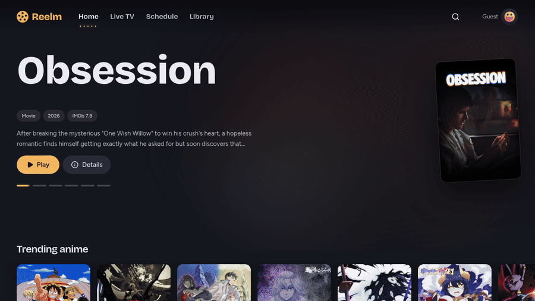
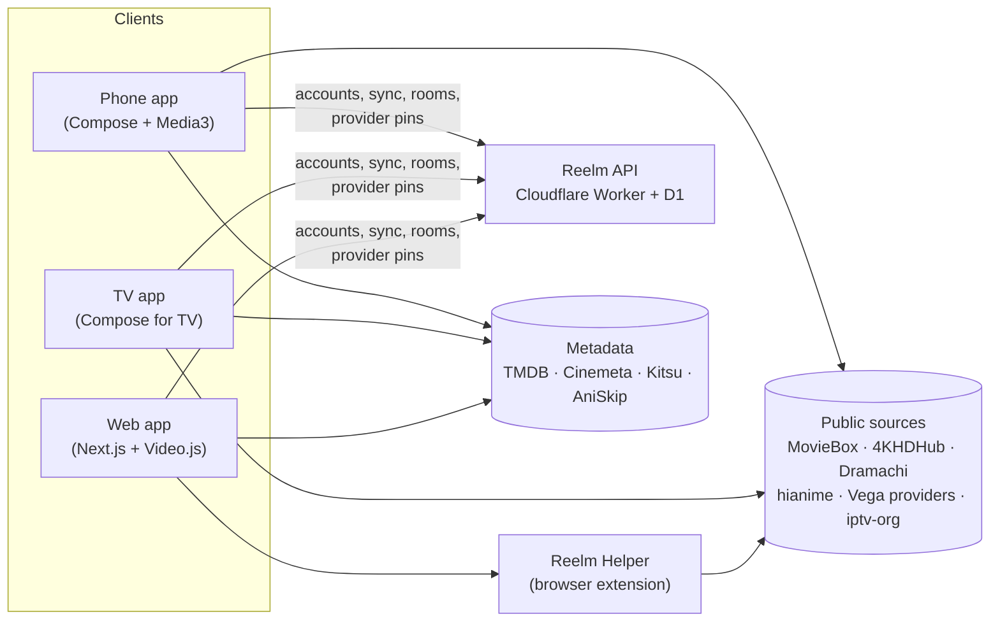

<div align="center">

# Reelm

**Anime, movies, series and live TV, on your phone, your TV and the web.**

One open-source streaming hub with a soft dusk UI. It hosts nothing: it finds what public sites already serve and plays it in a proper player.

[](../../releases/latest)
[](LICENSE)


[**Download the APK**](../../releases/latest) · [**Open the web app**](https://reelm-tv.vercel.app) · [How it works](#how-it-works) · [Build it](#build-from-source) · [Contribute](#contributing)

<br>



<sub>The web app, recorded live from reelm-tv.vercel.app</sub>

</div>

---

## Why Reelm

- **Everything in one place.** Anime with sub and dub, movies, TV series and thousands of live TV channels, behind one search box.
- **Many sources, one Play button.** Reelm asks several sources at once and picks the best stream that your connection and your device can actually play. If one dies mid-show, it moves to the next.
- **Made for the couch, too.** There's a real Android TV / Fire TV app built for the remote, down to a 2nd-gen Fire TV Stick.
- **Your progress follows you.** Accounts, profiles and sync let you start on the TV and finish on your phone. Pair a TV by scanning a code.
- **Watch together.** Open a room, share the code, and everyone's playback stays in sync.
- **No ads, no tracking networks.** It's GPL-3.0 and built in the open.

## Get it

| Platform | How |
|---|---|
| **Phone** (Android 8.0+) | Download `Reelm-v*.apk` from [Releases](../../releases/latest) and open it (allow "install unknown apps"). New versions install over the old one, and the app tells you when an update is out. |
| **Android TV / Fire TV** (Android 5.1+) | Download `Reelm-TV-v*.apk` from the same release. On Fire TV, install the *Downloader* app, allow it to install unknown apps, and open the release's APK link. |
| **Web** | Open **[reelm-tv.vercel.app](https://reelm-tv.vercel.app)**. Most sources also need the **Reelm Helper** extension (see below). |

<details>
<summary><b>Installing the Reelm Helper extension (web only)</b></summary>

<br>

Browsers won't let a web page send the headers that video sites expect, or read their replies across origins. The Helper does that one job: it fetches source pages from your own connection and sets the right `Referer`/`Origin`/`User-Agent` on the video requests. It only answers Reelm pages, and it never reaches private IPs.

1. Download `reelm-helper.zip` from the web app (or [`web/public/reelm-helper.zip`](web/public/reelm-helper.zip)) and unzip it.
2. **Chrome / Edge / Brave:** open `chrome://extensions`, turn on *Developer mode*, then click *Load unpacked* and choose the folder.
3. **Firefox 128+:** open `about:debugging#/runtime/this-firefox`, click *Load Temporary Add-on*, and choose `manifest.json`.

Store listings are planned. The source is in [`extension/`](extension/).

</details>

## Features

### Watching
- **Auto-quality.** Reelm measures your bandwidth and picks the highest quality that fits in 70% of it, skipping formats your device can't decode. If you choose a quality yourself, it's remembered for that show ("Pinned 1080p").
- **Fallback that just works.** If a stream fails, stalls, or plays sound with no picture, Reelm switches to the next source without stopping.
- **A full player.** Skip intro (from AniSkip), an *Up next* countdown, prev/next, an episode strip, ±10 s and double-tap seek, subtitles with a delay adjustment, sub/dub (falling back to sub when the dub isn't out), picture-in-picture, and background playback.
- **Resume anywhere.** Progress is saved as you watch and synced to your account.

### Finding something
- **One search for everything.** It asks MovieBox, Cinemeta and TMDB in parallel, re-asks TMDB with a corrected title when a typo finds nothing, then ranks and de-duplicates the results.
- **A rich home screen.** Trending hero, Continue Watching, and rows for latest episodes, top airing, most popular and more, plus recommendations.
- **Browse** by genre with infinite scroll, a 7-day anime airing schedule in your local time, and favourites.
- **Detail pages** for every title: synopsis, cast, seasons, an episode grid with range tabs (all 1,100+ episodes of One Piece), and related titles.
- **Live TV** from the open [iptv-org](https://github.com/iptv-org/iptv) channel list.

### Phone extras
- **Downloads.** Pick a quality and episodes from the detail page and watch offline in the full player. Play uses the downloaded file when you have one.
- **Stremio add-ons.** Paste an add-on manifest URL to add more stream sources to movies and TV.

### Accounts and households
- Sign in once and get **profiles** for everyone in the house. **Kids profiles** can never turn on mature content.
- **Mature filter**: erotic or explicit titles, music videos and sports clips are hidden unless a profile opts in.
- **TV pairing**: the TV shows a code, and you approve it from your phone or the web.
- **Admin pages** in the app and on the web: users, live sessions, source health, crash and version telemetry, and provider approval.

## On your phone

<div align="center">
&nbsp;
&nbsp;

<br>
&nbsp;
&nbsp;

</div>

## How it works



- **The apps do the scraping themselves.** Phone and TV fetch sources directly with OkHttp. The web app can't, because of CORS and blocked headers, so the Helper extension makes those requests for it. The backend never touches video.
- **Sources** live in `android/core/media` and `web/src/lib`. Each one turns a title into a list of playable streams with quality, language and the headers the host needs.
- **Vega providers.** Reelm runs the open-source [vega-providers](https://github.com/Zenda-Cross/vega-providers) scrapers **unchanged**. On Android they run in an embedded QuickJS engine with a small runtime (`android/vega-runtime`). On the web they run in the page, with requests going through the Helper. The API pins an approved upstream commit and an ordered list of enabled providers, so a bad upstream change can't break every app at once. An admin approves each update, and the apps only ask the top 10.
- **Every file is probed before it's offered.** Each file is requested the way a player would (`Range: bytes=0-`), and hosts that refuse it are dropped, so you don't pick a stream that was never going to play.
- **The backend** is a single Cloudflare Worker with a D1 (SQLite) database. It handles accounts, profiles, history and favourites sync, TV pairing, watch-together rooms over WebSockets, telemetry, and provider pinning. See the contract in [`server/API.md`](server/API.md).

## Repository layout

```
android/                  Gradle project: phone + TV flavors from one codebase
  app/                    entry point, navigation, DI, phone/tv flavors
  domain/                 models, repository contracts, use cases (PickStream, SearchRank, MaturePolicy)
  core/media              sources: MovieBox, 4KHDHub, Dramachi, Cinemeta, TMDB, live TV, add-ons, vega/
  core/parser             hianime parser (pure JVM, tested against real fixtures)
  core/network            OkHttp client, anime repository, downloader
  core/account            sign-in, profiles, sync, pairing
  core/database           Room: history, favourites, downloads, add-ons
  core/ui                 "Dusk Projector" design system
  feature/*               home, search, anime-detail, movies, player, livetv, downloads,
                          favorites, schedule, genre-browse, party, admin, tv
  player/                 shared Media3 player module
  vega-runtime/           esbuild project that builds the QuickJS runtime asset
web/                      Next.js App Router, Tailwind v4, Video.js 10
server/                   Cloudflare Worker (TypeScript) + D1 migrations
extension/                Reelm Helper (Manifest V3, Chrome + Firefox)
```

**Stack:** Kotlin 2.1, Jetpack Compose (Material 3 and tv-material), Hilt, Coroutines/Flow, Room, Media3 ExoPlayer, OkHttp, Jsoup, QuickJS · Next.js 16, React 19, Tailwind v4, Video.js 10, hls.js · Cloudflare Workers, D1, Durable Objects, Vitest.

## Build from source

### Android (phone + TV)

Requires JDK 17 and the Android SDK (compileSdk 35).

```bash
cd android
# optional: local.properties
#   TMDB_API_KEY=<your free TMDB v3 key>      # recommendations and TMDB search; skipped if empty
#   REELM_API_URL=<your API URL>              # accounts and sync; leave empty to run without them
./gradlew assemblePhoneDebug    # app/build/outputs/apk/phone/debug/app-phone-debug.apk
./gradlew assembleTvDebug       # app/build/outputs/apk/tv/debug/app-tv-debug.apk
./gradlew testDebugUnitTest     # unit tests
```

If you change `vega-runtime/src`, rebuild the bundled asset with `cd android/vega-runtime && npm ci && npm run build` and commit the result.

### Web

Requires Node 22.

```bash
cd web
npm ci
# .env.local
#   TMDB_API_KEY=<your TMDB key>
#   NEXT_PUBLIC_REELM_API_URL=<API URL>
npm run dev        # next dev --webpack, at http://localhost:3000
npm test           # stream picking, search ranking and Vega checks
```

Load `extension/` unpacked (see above) to play most sources locally.

### API

```bash
cd server
npm ci
npm test           # Vitest suite on the Workers runtime
npm run dev        # wrangler dev with a local D1
```

First-time deploy steps are in [`server/README.md`](server/README.md).

## Releases

- **Android:** every push to `main` that touches `android/` builds signed phone and TV APKs and publishes them as release `v1.0.N`. The in-app updater checks the latest release.
- **API:** changes to `server/` run the tests, apply D1 migrations and deploy the Worker.
- **Web:** changes to `web/` deploy to Cloudflare. Vercel deploys from GitHub.

## Contributing

Contributions are welcome, especially new or fixed **sources**, since sites change constantly.

- Open an issue first for anything bigger than a fix, so we can agree on the approach.
- Keep PRs focused. Use conventional-commit subjects (`fix(web): …`, `feat(android): …`).
- **Show it playing.** For player or source changes, include a screenshot or short clip of the video actually playing; "it compiles" isn't enough here.
- Run the tests for the part you touched (see [Build from source](#build-from-source)).
- UI work follows the design system in [`DESIGN-REELM.md`](DESIGN-REELM.md) and [`DESIGN.md`](DESIGN.md).

## Credits

- [ani-cli](https://github.com/pystardust/ani-cli), the scraping approach the anime side started from.
- [vega-providers](https://github.com/Zenda-Cross/vega-providers) for the movie and series providers.
- [iptv-org](https://github.com/iptv-org/iptv), [TMDB](https://www.themoviedb.org), [Cinemeta](https://v3-cinemeta.strem.io), [Kitsu](https://kitsu.io) and [AniSkip](https://aniskip.com) for channels and metadata.
- [quickjs-kt](https://github.com/dokar3/quickjs-kt), [Media3](https://developer.android.com/media/media3) and [Video.js](https://videojs.org).

## Disclaimer

Reelm hosts, uploads and stores no video. Everything it plays is fetched on demand from third-party sites, exactly as a web browser would. Whether streaming that content is legal depends on where you live, so use it at your own risk and within your local laws. See [DISCLAIMER.md](DISCLAIMER.md).

Licensed under [GPL-3.0](LICENSE).
